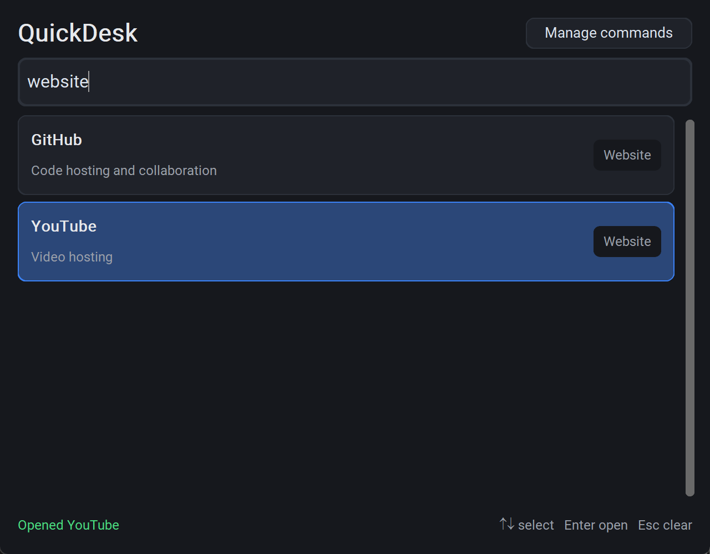

# QuickDesk

QuickDesk is a small desktop launcher for Windows. Type a few letters into one search box and open
an application, a folder, a file or a website without hunting through the Start menu or bookmarks.

It is a learning and portfolio project: the code is kept small, readable and covered by tests.



## Features

- **Instant search** that updates as you type:
  - case-insensitive;
  - matches the name, the description and the category (for example `website` or `folder`);
  - partial matches (`calc` finds *Calculator*, `hub` finds *GitHub*);
  - tolerates simple typos (`notpad`, `calcualtor`);
  - the best matches are shown first;
  - a clear message when nothing is found.
- **Built-in commands** on first start: Notepad, Calculator, Paint, File Explorer, the Downloads folder,
  GitHub and YouTube. They are protected and cannot be edited or deleted.
- **Your own commands**: add, edit and delete commands of three types: application (`.exe`),
  file or folder, and website.
- **Input validation**: websites must use `http://` or `https://`; files, folders and programs must exist.
- **Saved between runs** in `%APPDATA%\QuickDesk\commands.json`.
- **Keyboard control**:

  | Key           | Action                                   |
  |---------------|------------------------------------------|
  | `Ctrl+K`      | Focus the search box                     |
  | `Up` / `Down` | Move between results                     |
  | `Enter`       | Open the selected result                 |
  | `Escape`      | Clear the search / close an open dialog  |

- Dark, compact interface with small success and error messages at the bottom of the window.

## Technologies

- Python 3.11+
- [CustomTkinter](https://github.com/TomSchimansky/CustomTkinter) for the interface
- Python standard library only for everything else (`json`, `subprocess`, `webbrowser`, `difflib`, `pathlib`, ...)
- `unittest` and `unittest.mock` for tests

No network services, databases or AI APIs are used. Everything runs locally.

## Project structure

```
quickdesk/
├── main.py              # entry point: python main.py
├── requirements.txt
├── README.md
├── docs/
│   └── screenshot.png
├── quickdesk/
│   ├── __init__.py
│   ├── app.py           # interface: main window, command manager, add/edit dialog
│   ├── commands.py      # command model, validation, opening commands, built-ins
│   ├── search.py        # search and ranking
│   └── storage.py       # reading and writing commands.json
└── tests/
    ├── test_commands.py
    ├── test_search.py
    └── test_storage.py
```

## Installation and running (Windows)

1. Install [Python 3.11 or newer](https://www.python.org/downloads/) (tick *Add Python to PATH*).
2. Clone the repository and open the folder:

   ```powershell
   git clone https://github.com/<your-username>/quickdesk.git
   cd quickdesk
   ```

3. Create a virtual environment and install the dependency:

   ```powershell
   python -m venv .venv
   .venv\Scripts\activate
   pip install -r requirements.txt
   ```

4. Start the app:

   ```powershell
   python main.py
   ```

## Running the tests

```powershell
python -m unittest discover -s tests
```

The tests do not start programs, open websites or touch your real settings: system calls are mocked
and files are written to temporary folders. The tests do not need CustomTkinter.

## Example: adding your own command

1. Click **Manage commands**, then **Add command**.
2. Fill in the form, for example:

   | Field       | Value                          |
   |-------------|--------------------------------|
   | Name        | `Python docs`                  |
   | Description | `Official documentation`       |
   | Type        | `Website`                      |
   | Path or URL | `https://docs.python.org/3/`   |

3. Click **Save** (or press `Enter`). Now type `python` in the search box and press `Enter`.

Other examples:

- **Application**: `Code.exe` from `C:\Users\you\AppData\Local\Programs\Microsoft VS Code\Code.exe`
  (use the **File…** button), or just `notepad.exe` if the program is on `PATH`.
- **File or folder**: `C:\Users\you\Documents\Study` (use the **Folder…** button).
  Environment variables such as `%USERPROFILE%\Documents` also work.

The commands file is plain JSON, for example:

```json
{
  "version": 1,
  "commands": [
    {
      "id": "3f2c9a0e8b1d4b6f9c7a5e2d1b0a9f8e",
      "name": "Python docs",
      "description": "Official documentation",
      "type": "url",
      "target": "https://docs.python.org/3/",
      "builtin": false
    }
  ]
}
```

## Design decisions

- **Small modules with one job each.** `search.py`, `storage.py` and `commands.py` do not depend on
  the interface, so they are easy to test. `app.py` only connects them to widgets.
- **Safe launching.** No `eval`, `exec` or `shell=True`. Applications are started with
  `subprocess.Popen([path_to_exe])` and only `.exe` files are accepted, so a command cannot run `.bat`
  scripts or pass arguments to a terminal. Files and folders are opened with `os.startfile`, websites
  with `webbrowser.open`. Paths are checked right before opening.
- **Simple, explainable ranking.** Every query word must match. Exact word > word prefix > substring >
  close spelling (`difflib.SequenceMatcher`, only for words of 4+ letters). Matches in the name count
  more than matches in the description or category. See the docstring at the top of `search.py`.
- **User data outside the source folder.** Commands are stored in `%APPDATA%\QuickDesk\commands.json`.
  The file is written atomically (temporary file + replace), so a crash while saving cannot leave half
  a file. You can set the `QUICKDESK_HOME` environment variable to use another folder, which is handy
  for trying the app without touching your real data.
- **Damaged settings are never lost silently.** If `commands.json` is not valid, it is renamed to
  `commands.broken-<date>.json`, the defaults are restored and a message tells you where the old file is.
  If the backup cannot be made, QuickDesk starts with the defaults but refuses to save over the file.
- **Built-ins come from code.** Built-in commands are stored in the file too, but on every start they
  are refreshed from the code. This keeps them correct (for example, the real Downloads location is
  read from Windows, even if you moved the folder) and protects them from accidental changes.
- **Deleting a command only removes the entry** from `commands.json`. QuickDesk never deletes files.

## Limitations of version 0.1

- Windows is the main target. The core modules and tests also run on Linux/macOS, but the built-in
  commands are Windows programs and the interface was checked only on Windows.
- No global system-wide hotkey: shortcuts work only while the QuickDesk window is active.
- Commands cannot pass arguments to programs (this is intentional for safety).
- Application commands must be `.exe` files; to open a shortcut (`.lnk`) add it as *File or folder*.
- The window stays open after a command is opened; there is no tray icon.
- The interface is in English only.

## Ideas for the future

- Global hotkey to show/hide the window, and a system tray icon.
- Show recently or frequently used commands first.
- Icons for results (extracted from programs and websites).
- Import commands from Start menu shortcuts.
- Optional program arguments with a safe, explicit list of allowed values.
- Light theme and a settings window.
- Packaging into a single `.exe` with PyInstaller.
